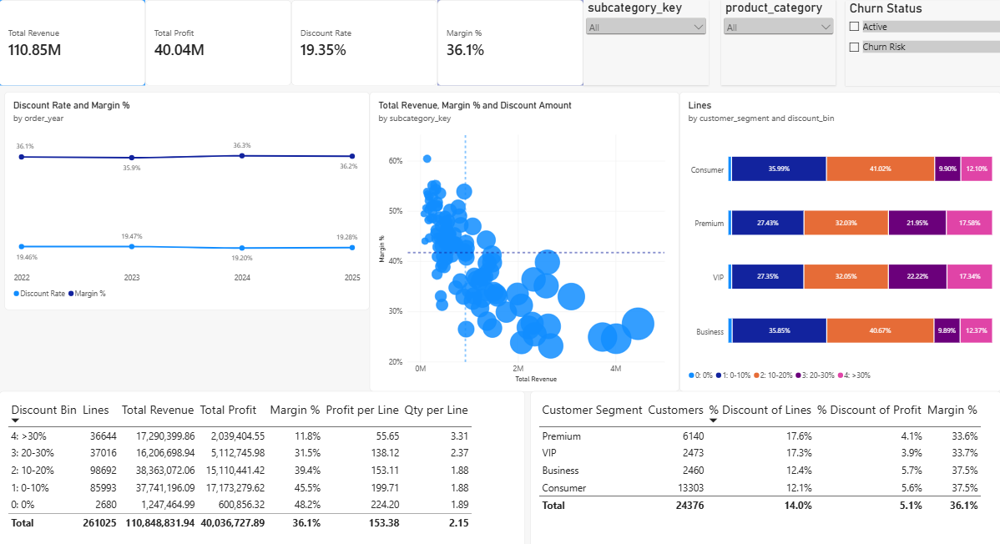
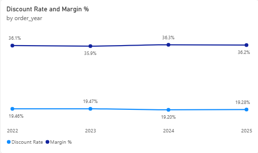
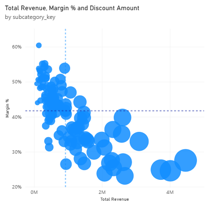
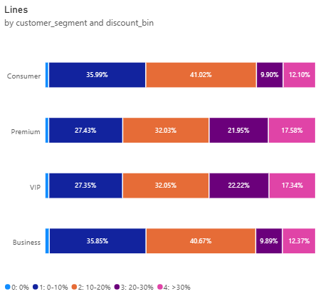

# E-Commerce Promotion Effectiveness: Discount Impact on Profit Margin by Product Category

> **Tools:** SQLite · SQL · Python (pandas) · Excel Pivot Table · Power BI (DAX)

---

## Table of Contents

1. [Introduction](#1-introduction)
2. [SQL](#2-sql)
3. [Python](#3-python)
4. [Excel Pivot Table](#4-excel-pivot-table)
5. [Power BI Dashboard](#5-power-bi-dashboard)
6. [Conclusions](#6-conclusions)
7. [Limitations](#7-limitations)

---

## 1. Introduction

**Main business question:**
> Does the current discount policy (`discount_percentage`) actually drive net profit, or is it hurting the profit margin of product categories?

**Sub-questions:**
1. What is the optimal discount level for each `sub_category` to stimulate demand while protecting profit?
2. Which `category` has high revenue but thin profit because of over-reliance on promotions?
3. How does the profit margin trend change from 2022 to 2025?

**Scope:** `Completed` orders only, 2022 – 2025. Sub-categories are grouped with `subcategory_key` (`category > subcategory`).

**Files in this part:**

| File | Role |
|---|---|
| `queries.sql` | Creates the `fact_order_promotion_analysis` table in SQLite |
| `Untitled.ipynb` | Cleaning, flagging, CSV export |
| `fact_order_promotion_clean.csv` | Input data for Excel and Power BI |
| `excel_pivot.xlsx` | Sheet `Table` (data) and sheet `Pivot` (5 Pivot Tables) |
| Power BI dashboard | Charts and detail tables |

---

## 2. SQL

**Purpose:** build a table with **one row per product line of an order**, including product category, discount level, revenue and profit after discount, the discount group (`discount_bin`), and customer information.

```sql
CREATE TABLE fact_order_promotion_analysis AS
SELECT
    oi.order_id,
    oi.product_id,
    p.product_name,
    p.product_category,
    p.product_subcategory,
    p.product_category || ' > ' || p.product_subcategory AS subcategory_key,
    p.brand,

    t.order_date,
    CAST(STRFTIME('%Y', t.order_date) AS INTEGER)AS order_year,
    CAST(STRFTIME('%m', t.order_date) AS INTEGER)AS order_month,
    STRFTIME('%Y-%m', t.order_date) AS order_year_month,
    CASE WHEN STRFTIME('%Y', t.order_date) BETWEEN '2022' AND '2025'
         THEN 1 ELSE 0 END AS in_scope_2022_2025,
    t.sales_channel,
    t.marketing_channel,

    t.customer_id,
    t.customer_segment,
    COALESCE(m.age_group, 'Unknown') AS age_group,
    COALESCE(m.gender, 'Unknown') AS gender,
    COALESCE(m.churn_status, 'Unknown') AS churn_status,
 
    oi.quantity,
    oi.unit_price,
    oi.discount_percentage,
    oi.discount_amount,
    oi.gross_sales,
    oi.tax_amount,
    oi.shipping_cost,
    oi.net_sales,
    oi.product_cost,
    oi.profit,
 
    ROUND(oi.gross_sales - oi.discount_amount, 2) AS revenue_clean,
    ROUND(oi.gross_sales - oi.discount_amount - oi.product_cost, 2) AS profit_clean,
    CASE WHEN (oi.gross_sales - oi.discount_amount) > 0
         THEN ROUND((oi.gross_sales - oi.discount_amount - oi.product_cost) * 100.0
                    / (oi.gross_sales - oi.discount_amount), 2)
         ELSE NULL END AS margin_clean_pct,

    CASE WHEN oi.discount_percentage > 0 THEN 1 ELSE 0 END AS has_discount,
    CASE
        WHEN oi.discount_percentage <= 0    THEN '0: 0%'
        WHEN oi.discount_percentage <= 0.10 THEN '1: 0-10%'
        WHEN oi.discount_percentage <= 0.20 THEN '2: 10-20%'
        WHEN oi.discount_percentage <= 0.30 THEN '3: 20-30%'
        ELSE '4: >30%'
    END AS discount_bin
FROM order_items oi
INNER JOIN ecommerce_sales_customer_analytics_150k t
        ON oi.order_id = t.order_id
LEFT  JOIN product_catalog p
        ON oi.product_id = p.product_id
LEFT  JOIN master_customer_summary m
        ON t.customer_id = m.customer_id
WHERE UPPER(TRIM(t.order_status)) = 'COMPLETED' AND CAST(STRFTIME('%Y', t.order_date) AS INTEGER) BETWEEN 2022 AND 2025;
```

**Structure:**

- **JOINs:** `INNER JOIN` with the orders table (keeps only lines that belong to an order), `LEFT JOIN` with `product_catalog` and `master_customer_summary` (keeps the line even if information is missing). Missing customer information is replaced by `'Unknown'`.
- **`WHERE`:** keeps only `Completed` orders; `UPPER(TRIM(...))` avoids mismatches caused by letter case and whitespace.
- **`revenue_clean = gross_sales − discount_amount`** and **`profit_clean = revenue_clean − product_cost`:** revenue and profit after discount, excluding tax and shipping, so that differences between groups reflect the effect of discounts.
- **`margin_clean_pct`:** expressed in percent (48.2, not 0.482), calculated only when revenue > 0, otherwise `NULL`.
- **`discount_bin`:** `CASE` evaluates from top to bottom and stops at the first true branch. The upper bound belongs to the lower group (exactly 0.10 falls in `1: 0-10%`). Labels start with a number so Pivot and Power BI sort them correctly.
- **`in_scope_2022_2025`** is always 1 because `WHERE` already filters the years.

---

## 3. Python

**Purpose:** read the table from SQLite, check data quality, add two flag columns, and export `fact_order_promotion_clean.csv`.

```python
import sqlite3
import numpy as np
import pandas as pd

con = sqlite3.connect(db_path)
df = pd.read_sql("SELECT * FROM fact_order_promotion_analysis", con)
con.close()

for c in df.select_dtypes(include=["object", "string"]).columns:
    df[c] = df[c].astype("string").str.strip()

na = df.isna().sum()
df = df.drop_duplicates()

m = df["margin_clean_pct"]
df["margin_flag"] = np.select([m.isna(), df["profit_clean"] < 0, m < 20],
                              ["Unknown", "Loss", "Thin"], default="OK")

df["dq_note"] = np.where(df.duplicated(["order_id", "product_id"], keep=False),
                         "repeat_product_in_order", "OK")

df.to_csv("fact_order_promotion_clean.csv", index=False, encoding="utf-8-sig")
```

**Structure:**

- **String cleaning:** the `.str.strip()` loop runs over every string column, so labels such as `"Electronics"` and `"Electronics "` are not split into two groups.
- **Missing and duplicate check:** the notebook output shows no missing columns and **261,025 rows before and after removing duplicates** (`drop_duplicates()` only removes rows that are identical in every column).
- **`margin_flag`:** `np.select` evaluates conditions from top to bottom, so a loss-making row is tagged `Loss` rather than `Thin`.

| Label | Condition |
|---|---|
| Unknown | Margin cannot be calculated |
| Loss | `profit_clean < 0` |
| Thin | Margin below 20% |
| OK | Everything else |

- **`dq_note`:** `keep=False` flags **all** rows of a repeated `order_id` + `product_id` pair. The flag is only a note; no row is deleted.
- **Result:** the CSV file has **261,025 rows × 36 columns**.

---

## 4. Excel Pivot Table

**Purpose:** examine the relationship between discount level and profit by product category, in order to assess Base vs Incremental volume and signs of Cannibalization.

**Setup:** the `Table` sheet holds the data; a Calculated Field `Margin %` = `profit_clean / revenue_clean` is created (a **weighted** ratio: Σ profit ÷ Σ revenue, meaning lines with larger revenue have more influence than lines with smaller revenue). Tables are shown at category level (collapsed).

| Pivot | Rows | Columns | Values |
|---|---|---|---|
| 1 | `product_category` > `subcategory_key` | `discount_bin` | Σ `revenue_clean` |
| 2 | `product_category` > `subcategory_key` | `discount_bin` | Σ `profit_clean` |
| 3 | `product_category` > `subcategory_key` | `discount_bin` | `Margin %` |
| 4 | `discount_bin` | none | Line count, Σ `profit_clean`, Average `margin_clean_pct`, Average `quantity`, Average `profit_clean` |
| 5 | `discount_bin` | `subcategory_key` (Top 10 by Σ `revenue_clean`) | `Margin %`, Σ `revenue_clean` |

### Pivot 1: Revenue

| Category | 0: 0% | 1: 0-10% | 2: 10-20% | 3: 20-30% | 4: >30% | Total |
|---|---|---|---|---|---|---|
| Automotive | 89,733 | 3,284,868 | 3,235,999 | 1,450,731 | 1,460,104 | 9,521,435 |
| Baby & Kids | 53,641 | 1,948,981 | 1,927,949 | 815,391 | 893,151 | 5,639,112 |
| Beauty & Personal Care | 27,866 | 879,529 | 937,811 | 384,391 | 407,429 | 2,637,026 |
| Books & Media | 17,036 | 520,151 | 542,514 | 218,337 | 232,021 | 1,530,058 |
| Electronics | 267,168 | 8,271,387 | 8,198,075 | 3,486,768 | 3,577,247 | 23,800,645 |
| Fashion | 45,350 | 1,415,111 | 1,515,984 | 615,114 | 674,775 | 4,266,335 |
| Grocery | 19,964 | 556,332 | 569,965 | 228,294 | 253,551 | 1,628,105 |
| Health & Wellness | 64,193 | 1,751,238 | 1,832,641 | 782,985 | 830,811 | 5,261,868 |
| Home & Kitchen | 69,712 | 2,134,482 | 2,219,124 | 906,153 | 986,496 | 6,315,967 |
| Home Appliances | 176,171 | 4,827,862 | 5,048,129 | 2,099,371 | 2,379,349 | 14,530,881 |
| Jewelry | 182,973 | 5,098,007 | 5,106,190 | 2,171,347 | 2,353,816 | 14,912,333 |
| Office Supplies | 53,942 | 1,707,421 | 1,771,141 | 727,063 | 787,315 | 5,046,883 |
| Pet Supplies | 45,730 | 1,221,788 | 1,245,012 | 529,692 | 604,945 | 3,647,167 |
| Sports & Outdoors | 101,878 | 3,079,359 | 3,126,435 | 1,336,521 | 1,373,016 | 9,017,210 |
| Toys & Games | 32,108 | 1,044,680 | 1,086,102 | 454,543 | 476,375 | 3,093,808 |
| **Total** | **1,247,465** | **37,741,196** | **38,363,072** | **16,206,699** | **17,290,400** | **110,848,832** |

### Pivot 2: Profit

| Category | 0: 0% | 1: 0-10% | 2: 10-20% | 3: 20-30% | 4: >30% | Total |
|---|---|---|---|---|---|---|
| Automotive | 39,020 | 1,380,773 | 1,138,993 | 395,566 | 76,539 | 3,030,890 |
| Baby & Kids | 28,831 | 1,020,625 | 911,232 | 328,588 | 199,055 | 2,488,330 |
| Beauty & Personal Care | 16,198 | 497,141 | 482,824 | 174,547 | 119,079 | 1,289,789 |
| Books & Media | 10,363 | 303,215 | 289,541 | 103,575 | 73,205 | 779,898 |
| Electronics | 107,778 | 2,991,663 | 2,378,023 | 702,472 | -102,841 | 6,077,095 |
| Fashion | 24,779 | 743,127 | 708,471 | 247,105 | 151,604 | 1,875,086 |
| Grocery | 12,771 | 338,094 | 320,796 | 114,859 | 91,724 | 878,245 |
| Health & Wellness | 32,925 | 860,322 | 801,155 | 283,847 | 147,026 | 2,125,275 |
| Home & Kitchen | 36,178 | 1,067,906 | 982,218 | 329,585 | 185,976 | 2,601,864 |
| Home Appliances | 83,100 | 2,124,418 | 1,894,213 | 609,793 | 204,590 | 4,916,115 |
| Jewelry | 81,813 | 2,185,921 | 1,846,919 | 620,623 | 185,639 | 4,920,915 |
| Office Supplies | 30,419 | 934,860 | 875,915 | 310,028 | 201,605 | 2,352,826 |
| Pet Supplies | 26,224 | 664,115 | 608,698 | 223,013 | 156,589 | 1,678,639 |
| Sports & Outdoors | 51,933 | 1,489,653 | 1,331,244 | 471,482 | 221,126 | 3,565,437 |
| Toys & Games | 18,523 | 571,447 | 540,200 | 197,664 | 128,489 | 1,456,324 |
| **Total** | **600,856** | **17,173,280** | **15,110,441** | **5,112,746** | **2,039,405** | **40,036,728** |

### Pivot 3: Margin % (weighted)

| Category | 0: 0% | 1: 0-10% | 2: 10-20% | 3: 20-30% | 4: >30% | Total |
|---|---|---|---|---|---|---|
| Automotive | 43.5% | 42.0% | 35.2% | 27.3% | 5.2% | 31.8% |
| Baby & Kids | 53.7% | 52.4% | 47.3% | 40.3% | 22.3% | 44.1% |
| Beauty & Personal Care | 58.1% | 56.5% | 51.5% | 45.4% | 29.2% | 48.9% |
| Books & Media | 60.8% | 58.3% | 53.4% | 47.4% | 31.6% | 51.0% |
| Electronics | 40.3% | 36.2% | 29.0% | 20.1% | -2.9% | 25.5% |
| Fashion | 54.6% | 52.5% | 46.7% | 40.2% | 22.5% | 44.0% |
| Grocery | 64.0% | 60.8% | 56.3% | 50.3% | 36.2% | 53.9% |
| Health & Wellness | 51.3% | 49.1% | 43.7% | 36.3% | 17.7% | 40.4% |
| Home & Kitchen | 51.9% | 50.0% | 44.3% | 36.4% | 18.9% | 41.2% |
| Home Appliances | 47.2% | 44.0% | 37.5% | 29.0% | 8.6% | 33.8% |
| Jewelry | 44.7% | 42.9% | 36.2% | 28.6% | 7.9% | 33.0% |
| Office Supplies | 56.4% | 54.8% | 49.5% | 42.6% | 25.6% | 46.6% |
| Pet Supplies | 57.3% | 54.4% | 48.9% | 42.1% | 25.9% | 46.0% |
| Sports & Outdoors | 51.0% | 48.4% | 42.6% | 35.3% | 16.1% | 39.5% |
| Toys & Games | 57.7% | 54.7% | 49.7% | 43.5% | 27.0% | 47.1% |
| **Total** | **48.2%** | **45.5%** | **39.4%** | **31.5%** | **11.8%** | **36.1%** |

### Pivot 4: Comparison of discount groups

| Discount Bin | Lines | Total Profit | Avg margin (simple) | Avg Qty per Line | Avg Profit per Line |
|---|---|---|---|---|---|
| 0: 0% | 2,680 | 600,856 | 53.10% | 1.89 | 224.20 |
| 1: 0-10% | 85,993 | 17,173,280 | 50.54% | 1.88 | 199.71 |
| 2: 10-20% | 98,692 | 15,110,441 | 44.91% | 1.88 | 153.11 |
| 3: 20-30% | 37,016 | 5,112,746 | 38.23% | 2.37 | 138.12 |
| 4: >30% | 36,644 | 2,039,405 | 17.75% | 3.31 | 55.65 |
| **Total** | **261,025** | **40,036,728** | **42.09%** | **2.15** | **153.38** |

> The "Avg margin" column in Pivot 4 is the **simple average** of each line's `margin_clean_pct`, so it is higher than the weighted margin (for example the 0% group: 53.10% vs 48.2%). The weighted margin is the main figure in this project.

### Pivot 5: Top 10 sub-categories by revenue (weighted Margin %)

| Sub-category | 0% | 0-10% | 10-20% | 20-30% | >30% | Total margin | Total revenue |
|---|---|---|---|---|---|---|---|
| Electronics > Smartphones | 42.0% | 38.2% | 31.2% | 22.2% | 1.2% | 27.5% | 4,460,237 |
| Electronics > TVs | 41.3% | 35.3% | 27.9% | 19.5% | -6.1% | 24.6% | 4,012,379 |
| Electronics > Smart Watches | 38.0% | 35.2% | 28.0% | 19.6% | -3.7% | 24.9% | 3,732,931 |
| Jewelry > Rings | 46.8% | 42.3% | 36.5% | 28.7% | 7.8% | 33.0% | 3,093,445 |
| Electronics > Tablets | 37.4% | 34.0% | 26.4% | 16.9% | -4.9% | 23.1% | 2,671,165 |
| Jewelry > Bracelets | 41.0% | 37.7% | 30.8% | 22.0% | -1.5% | 27.0% | 2,619,970 |
| Home Appliances > Toasters | 52.6% | 48.7% | 42.7% | 34.7% | 16.3% | 39.8% | 2,602,990 |
| Home Appliances > Blenders | 47.0% | 44.2% | 38.8% | 29.9% | 11.1% | 35.1% | 2,578,838 |
| Electronics > Laptops | 41.5% | 36.2% | 29.4% | 20.0% | -3.0% | 25.4% | 2,341,379 |
| Jewelry > Earrings | 43.6% | 46.3% | 39.5% | 33.0% | 13.3% | 36.4% | 2,319,305 |
| **Top 10** | **43.1%** | **39.2%** | **32.6%** | **24.2%** | **2.4%** | **29.1%** | **30,432,639** |

### Base vs Incremental and Cannibalization

- **From 0% to 20%, discounts increase but customers do not buy more:** average quantity per line is 1.89, 1.88, 1.88, while profit per line falls 224 → 200 → 153.
- **From 20% upward, quantity rises (2.37, then 3.31) but profit per line keeps falling** (138, then 56).
- **Revenue rises while profit drops:** the `20–30%` and `>30%` groups have a similar number of lines (37,016 and 36,644). The `>30%` group has 6.7% higher revenue (17.29M vs 16.21M) but 60.1% lower profit (2.04M vs 5.11M).
- **Sign of Cannibalization:** at 10–20%, customers buy the same quantity at a lower price, meaning the discount is eating into base volume. This is a sign drawn from comparing groups, not a causal conclusion.
- **High-revenue sub-categories with thin margin (Pivot 5):** the margin of all 10 sub-categories falls steadily as the discount level rises. In the `>30%` group, 5 sub-categories are negative (TVs, Tablets, Smart Watches, Laptops, Bracelets); Smartphones, the largest sub-category, is only +1.2%.
- **Category:** Electronics is the only category with a loss in the `>30%` group (profit −102,841).

---

## 5. Power BI Dashboard

Load `fact_order_promotion_clean.csv` into Power BI.



**Headline figures:** 261,025 lines · 24,376 customers · revenue $110.85M · profit $40.04M · margin 36.1% · discount rate 19.35%.

### 5.1. DAX measures

Measures are named differently from the columns (`Total Profit` instead of `Profit`) because Power BI does not allow a measure to share a name with a column in the same table.

```dax
Total Revenue    = SUM ( fact_order_promotion_clean[revenue_clean] )
Total Profit     = SUM ( fact_order_promotion_clean[profit_clean] )
Gross Sales      = SUM ( fact_order_promotion_clean[gross_sales] )
Discount Amount  = SUM ( fact_order_promotion_clean[discount_amount] )
Lines            = COUNTROWS ( fact_order_promotion_clean )
Customers        = DISTINCTCOUNT ( fact_order_promotion_clean[customer_id] )

Margin %         = DIVIDE ( [Total Profit], [Total Revenue] )
Discount Rate    = DIVIDE ( [Discount Amount], [Gross Sales] )
Profit per Line  = DIVIDE ( [Total Profit], [Lines] )
Avg Qty per Line = AVERAGE ( fact_order_promotion_clean[quantity] )

Deep Discount Lines      = CALCULATE ( [Lines], fact_order_promotion_clean[discount_bin] = "4: >30%" )
Deep Discount % of Lines = DIVIDE ( [Deep Discount Lines], [Lines] )
Deep Discount % of Profit =
    DIVIDE (
        CALCULATE ( [Total Profit], fact_order_promotion_clean[discount_bin] = "4: >30%" ),
        [Total Profit]
    )
```

- `Lines` is the number of **product lines within orders** (one order can have several lines).
- `Margin %` and `Discount Rate` are **weighted** ratios (total divided by total), so they are correct at every level of aggregation: overall, by year, by group. `DIVIDE` returns blank instead of an error when the denominator is 0.
- `CALCULATE` replaces the filter on the named column, so the `Deep Discount ...` measures are always fixed to the `>30%` group and should not be placed next to `discount_bin` in the same visual.

### 5.2. Discount and margin trend



| Year | Discount rate | Margin % |
|---|---|---|
| 2022 | 19.46% | 36.1% |
| 2023 | 19.47% | 35.9% |
| 2024 | 19.20% | 36.3% |
| 2025 | 19.28% | 36.2% |

Both lines are almost flat, with no upward or downward trend over time.

### 5.3. Scatter: revenue, margin and discount amount by sub-category



The X axis is `Total Revenue`, the Y axis is `Margin %`, bubble size is `Discount Amount`, and each bubble is a `subcategory_key`. The two reference lines are average lines (Analytics → Average line). The **bottom-right quadrant** (revenue above average, margin below average) is the "big revenue, thin profit" group. The larger the bubble (more discount money), the lower and further right it sits.

### 5.4. Discount group comparison table (with `subcategory_key` slicer)

| Discount Bin | Lines | Total Revenue | Total Profit | Margin % | Profit per Line | Qty per Line |
|---|---|---|---|---|---|---|
| 4: >30% | 36,644 | 17,290,399.86 | 2,039,404.55 | 11.8% | 55.65 | 3.31 |
| 3: 20-30% | 37,016 | 16,206,698.94 | 5,112,745.98 | 31.5% | 138.12 | 2.37 |
| 2: 10-20% | 98,692 | 38,363,072.06 | 15,110,441.42 | 39.4% | 153.11 | 1.88 |
| 1: 0-10% | 85,993 | 37,741,196.09 | 17,173,279.62 | 45.5% | 199.71 | 1.88 |
| 0: 0% | 2,680 | 1,247,464.99 | 600,856.32 | 48.2% | 224.20 | 1.89 |
| **Total** | **261,025** | **110,848,831.94** | **40,036,727.89** | **36.1%** | **153.38** | **2.15** |

Select a sub-category in the slicer to see the table for that sub-category; the best discount level is the row with the highest `Profit per Line` (or `Total Profit`).

### 5.5. Customer segments and promotion behavior



| Segment | 0-10% | 10-20% | 20-30% | >30% |
|---|---|---|---|---|
| Consumer | 35.99% | 41.02% | 9.90% | 12.10% |
| Premium | 27.43% | 32.03% | 21.95% | 17.58% |
| VIP | 27.35% | 32.05% | 22.22% | 17.34% |
| Business | 35.85% | 40.67% | 9.89% | 12.37% |

| Customer Segment | Customers | Deep discount (>30%) % of lines | Deep discount (>30%) % of profit | Margin % |
|---|---|---|---|---|
| Premium | 6,140 | 17.6% | 4.1% | 33.6% |
| VIP | 2,473 | 17.3% | 3.9% | 33.7% |
| Business | 2,460 | 12.4% | 5.7% | 37.5% |
| Consumer | 13,303 | 12.1% | 5.6% | 37.5% |
| **Total** | **24,376** | **14.0%** | **5.1%** | **36.1%** |

---

## 6. Conclusions

### Main question: do discounts drive net profit?

**Discounts of 10% and above reduce net profit, and the damage grows quickly as discounts get deeper.**

| Discount level | Margin | Profit per line | Quantity per line |
|---|---|---|---|
| 0 – 10% | 45.5% | 200 | 1.88 |
| 10 – 20% | 39.4% | 153 | 1.88 |
| 20 – 30% | 31.5% | 138 | 2.37 |
| > 30% | 11.8% | 56 | 3.31 |

The `>30%` group accounts for 15.6% of revenue but only 5.1% of profit. Deep discounts bring more quantity, but profit per line falls by about 75% compared with the 0% group.

### Sub-question 1: optimal discount level

**Around 0 – 10%.** Profit per line is highest in the 0% and 0–10% groups; among the Top 10 sub-categories, the highest margin is always in the 0% or 0–10% group and it declines steadily in higher groups. To check a specific sub-category, use the table in 5.4 with the slicer.

### Sub-question 2: high revenue but thin profit

**Electronics** (largest revenue at 23.8M, margin 25.5%, a loss in the `>30%` group), followed by **Automotive, Jewelry and Home Appliances** (margin only 5.2% – 8.6% in the `>30%` group).

Electronics does not put more of its revenue into the deep-discount group than the overall average (15.0% vs 15.6% of total revenue). Its margin is low because of a **low base margin**: in the 0% group Electronics has only 40.3% while Grocery has 64.0%, so the same discount pushes Electronics negative while Grocery keeps 36.2% in the `>30%` group.

### Sub-question 3: margin trend 2022 – 2025

**Almost unchanged:** margin 36.1% → 35.9% → 36.3% → 36.2%, discount rate 19.5% → 19.5% → 19.2% → 19.3%.

### Customer segments

Premium and VIP receive deeper discounts (17.3% – 17.6% of lines in the `>30%` group, versus 12.1% – 12.4% for Consumer and Business) and have lower margins (33.6% – 33.7% versus 37.5%).

### Recommendations (not yet validated)

1. Cap discounts at around 10% for most products.
2. Review sub-categories that lose money in the `>30%` group, starting with Electronics.
3. Revisit discount policy by the margin of each category, and for Premium and VIP.

---

## 7. Limitations

**Method**
- **Causality is not proven:** there is no period without promotions and no control group, so Base vs Incremental and Cannibalization are only signs drawn from comparing groups.
- **The 0% group is very small:** 2,680 lines (about 1.0% of the total), so comparing the 0% group at sub-category level is unreliable.
- **Discount group cut-offs** (10%, 20%, 30%) are the analyst's choice; the optimal level cannot be determined more finely than the width of a group. The `Thin` threshold (margin below 20%) is also an assumption.
- **Two ways of calculating margin give different numbers:** the project uses the weighted margin (36.1%), while the Average of `margin_clean_pct` in Pivot 4 is a simple average.
- **Pivots stop at category level and the Top 10 sub-categories.** The optimal discount has not been summarized for all sub-categories; the dashboard slicer must be used to view each one.
- **Not checked whether the discount level is linked to purchase quantity.** If larger orders receive larger discounts, the quantity increase in high-discount groups is not necessarily caused by discounts stimulating demand.
- **Average discount levels have not been compared directly across categories.** The statement "Electronics is not discounted more" is based only on the share of revenue in the `>30%` group.

**Data**
- Only `Completed` orders, 2022 – 2025.
- `profit_clean` does not subtract tax and shipping cost.
- **The source tables** `order_items`, `product_catalog` and `master_customer_summary` were not available among the attached files and were **not checked**: join keys, duplicate rows, missing values.
- Some `order_id` + `product_id` pairs appear on several lines; they are kept and flagged `repeat_product_in_order`, but their number has not been counted.
- `discount_bin` does not handle an empty `discount_percentage`: a `NULL` falls into the `ELSE` branch and is wrongly placed in `>30%`. The notebook reports no missing columns, but with new data a `WHEN oi.discount_percentage IS NULL THEN 'Unknown'` branch should be added at the top of the `CASE`.
- There is no promotion cost other than the discount itself (campaigns, advertising), so promotion ROI cannot be calculated.

**Scope**
- RFM segments (`rfm_segment`) from the Customer Analytics project have not been combined; the customer part uses `customer_segment`. The question of "deal hunters" versus the Pareto group is not answered directly.
- The `Churn Status` filter is on the dashboard but has not been used to draw conclusions.
- This is a descriptive analysis; the recommendations in section 6 have not been validated.
